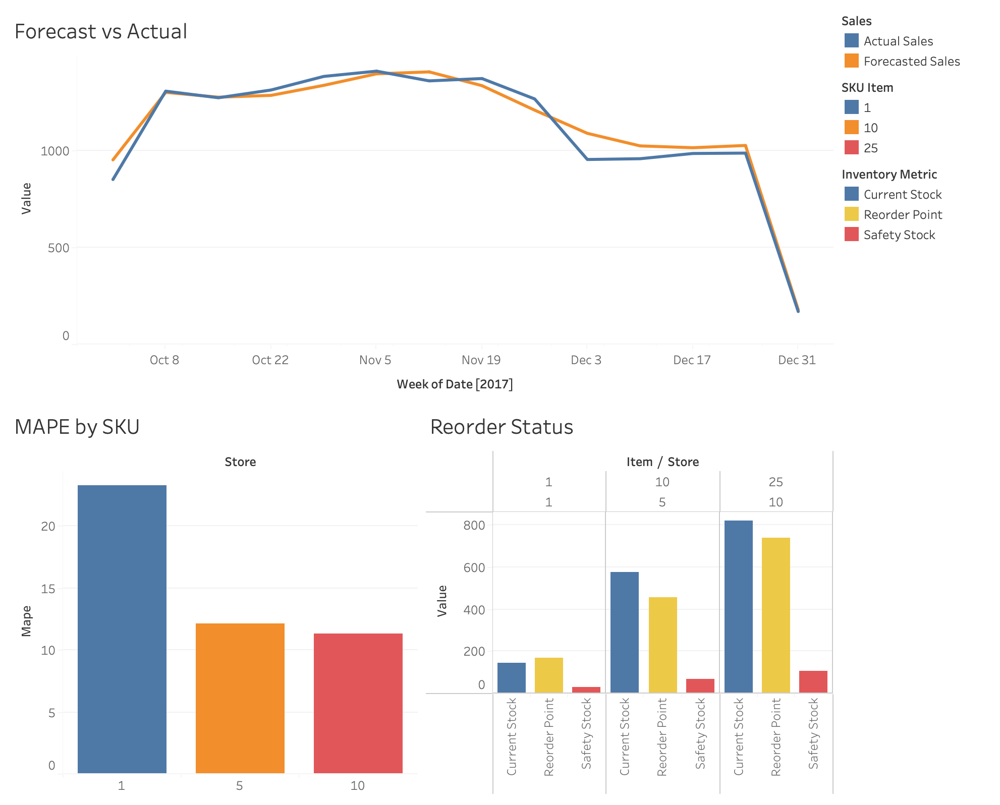
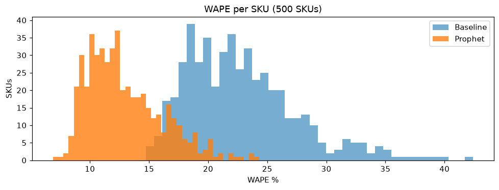
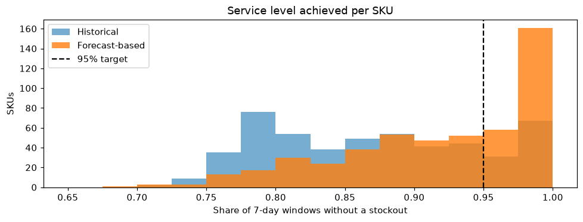

# RetailStock: Demand Forecasting & Safety-Stock Planner

[](https://github.com/thaenandarhtet-iris/retailstock-demand-forecaster/actions/workflows/tests.yml)
[](https://github.com/thaenandarhtet-iris/retailstock-demand-forecaster/actions/workflows/scrape.yml)
[](LICENSE)

Forecasts daily demand for 500 retail SKUs (10 stores × 50 items, five years of sales) and turns the forecasts into safety stock and reorder points. It then checks those inventory levels against what customers actually bought.

**Live dashboard:** [Tableau Public](https://public.tableau.com/views/RetailStockDemandandReplenishmentDashboard/RetailstockDemandReplenishmentDashboard)



## The problem

A retailer has to balance two costs: running out of stock and losing sales, or holding too much and tying up cash. The buffer you need, the safety stock, depends on how *uncertain* demand is. The question this project answers is how much of that uncertainty a good forecast can remove.

## Results

Measured on the last 90 days of data (October to December 2017), which no model saw during training.

**Forecasting.** One Prophet model per SKU, with weekly and yearly seasonality, compared with a simple baseline that repeats the last week of sales:

| | Prophet | Baseline |
|---|---|---|
| Overall WAPE | **11.6%** | 21.3% |
| SKUs where it's more accurate | **500 of 500** | |
| Median WAPE per SKU | 12.2% | 22.0% |



**Inventory.** A 7-day supplier lead time and a 95% target service level. The original version of this project sized safety stock from the spread of all past daily sales. The new version sizes it from the spread of *forecast errors*:

| Safety stock based on | Total safety stock | Service level achieved |
|---|---|---|
| Past sales variability (original) | 32,209 units | 88.0% |
| Forecast errors (new) | **16,795 units** (−48%) | **92.9%** |



**Half the buffer and fewer stockouts.** The forecast already explains the weekly and yearly patterns, so the remaining uncertainty is much smaller. The original method had a second problem: it used the five-year average demand, which lags behind today's higher sales, so its reorder points were too low even with the bigger buffer.

**Why 92.9% and not 95%.** The test period includes the late-November surge, which the model under-forecasts slightly. Adding US holidays to Prophet made no real difference (93.4%), because this dataset has no genuine holiday effects. A production system would re-estimate the buffer weekly on recent errors, or raise it for peak season.

## How it works

1. **Forecast** (`src/forecast.py`): fits Prophet for each of the 500 SKUs in parallel on everything except the last 90 days, forecasts those 90 days, and scores Prophet against the baseline. WAPE (total error ÷ total sales) is the headline metric; MAPE and bias are also reported per SKU.
2. **Size inventory** (`src/inventory.py`): safety stock = z × σ × √(lead time), with z = 1.645 for 95%. The reorder point is the forecast demand over the next 7 days plus safety stock. To keep the test fair, σ is measured on the first 45 days of the holdout and the service level is checked on the other 45, so no day is used for both.
3. **Export** (`src/dashboard.py`): writes `data/processed/dashboard_data.xlsx` for Tableau. It has three sheets: forecast vs actual, accuracy per SKU, and reorder status.

The notebooks in `notebooks/` walk through the analysis with charts: EDA, forecast accuracy, safety stock, and the dashboard export.

## 2.0: Price & Promo Intelligence

1.0 knows nothing about price or promotions, and in real retail those are the two biggest levers a business pulls. So 2.0 asks four questions: which promotions actually made money, how sensitive each product is to price, whether knowing price and promo makes the forecast better, and how real stores compare on price for the same products.

The full design, including every method and why it was chosen, is in [docs/design](docs/design/2026-09-30-retailstock-2.0-design.md).

### Where the data comes from

No single source has everything. Retail websites show prices and promotions but never how many units they sold, and sales datasets have units but usually no prices. So 2.0 uses three sources, each for what it's good at:

| Source | What it has | Used for |
|---|---|---|
| **M5 (Walmart, Kaggle)** | Daily unit sales and weekly prices, 2011 to 2016 | Promo lift, promo profit, price sensitivity, and the forecast |
| **Open Prices API (Open Food Facts)** | Real shelf prices from US grocery stores, with a discount flag | The competitor price index |
| **webscraper.io test store** | Product listings that load with JavaScript | Shows the Selenium scraper working end to end |

From M5 I use one store (`CA_1`) and one department (`FOODS_3`), and within that the 200 items whose price changed most often, because you can't measure price sensitivity on a price that never moves.

**Why not Target?** Target was the first choice, but its Terms & Conditions ban scraping outright and its robots.txt blocks the deals pages. This project only uses sources that allow it.

### Results

**Promotions.** 236 promotions in the 200 items had a clean four weeks before and two weeks after to compare against. The typical one took 17% off the price.

To measure lift fairly, each promoted item is compared with items in the same department that weren't on promotion at the same time (difference-in-differences). Otherwise a promo that happened to run over a holiday would get credit for the holiday.

| | Result |
|---|---|
| Median sales lift during the promo | **+59%** |
| Median change in the two weeks after | +1.3 units/day (no stock-up dip) |
| Promotions that made money at a 30% margin | **52%** |
| ...at a 25% margin / at a 35% margin | 44% / 61% |

**About half the promotions lost money,** even though almost all of them lifted sales. The discount on units that would have sold anyway often cost more than the extra sales brought in. M5 has no cost data, so profit assumes a 30% gross margin, and the 25% and 35% rows show how much the answer depends on that. I expected shoppers to stock up and buy less afterwards, but in this data sales after a promo were usually a little *higher*, so there was no dip to subtract.

**Price sensitivity.** For each item, a regression of weekly sales on price, controlling for promotions and the time of year:

| | Result |
|---|---|
| Median elasticity | **−2.8** (a 1% price rise cuts demand by about 2.8%) |
| Items where the estimate is clearly negative (95% interval below zero) | 59% |
| Items with a positive estimate (higher price, more sales) | 30% |

The median is believable for grocery, but the individual estimates aren't. They range from −18 to +30, and 30% of items show demand *rising* with price. That isn't real; it's what happens when you measure price effects from observational data where prices weren't set at random (see Limitations). So the stock what-if below doesn't trust any item's estimate outside −4 to 0, and flags the ones it had to adjust (141 of 200).

**Forecasting with price and promo.** Each model was tested on four separate 28-day periods at the end of the M5 data, rather than one holdout:

| Overall WAPE | Baseline | Prophet (1.0) | Prophet + price and promo |
|---|---|---|---|
| Average of 4 periods | 64.8% | 64.7% | **64.3%** |

**Knowing price and promo barely helps here,** and Prophet barely beats the simple baseline. That's very different from 1.0, where Prophet halved the error. M5 grocery items sell a handful of units a day with lots of zero days, which is much harder to forecast than the smooth Kaggle data. The honest conclusion is that on this kind of product, price and promo information alone isn't enough to make a better forecast.

**Stock ahead of a promotion.** Using each item's price sensitivity and promo effect, a 20% promotion next week would need the median reorder point to go up by **66%**. This is the number a planner would act on, which is why the implausible elasticities are clipped before it's calculated.

**Competitor prices.** Comparing identical products (same barcode) seen in at least two Bay Area stores in the last 30 days, where 100 means a store prices at the middle of the market:

| Store | Products compared | Price index |
|---|---|---|
| Whole Foods Market Los Altos | 12 | 103.2 |
| Sprouts Farmers Market Sunnyvale | 7 | 100.0 |
| Safeway Mountain View | 6 | 98.4 |
| Whole Foods Market Sunnyvale | 4 | 102.7 |
| Smart & Final Mountain View | 3 | 74.7 |

Whole Foods comes out a few percent above the market and Safeway slightly below, which matches what you'd expect. But only a few dozen products overlap so far, so treat this as a working pipeline rather than a finding. The daily scrape adds more each day.

### How 2.0 works

1. **Scrape** (`scrape/`): every day at 13:00 UTC a GitHub Action runs a Selenium scraper on the test store and pulls the last 30 days of US prices from the Open Prices API. Both write to `landing/raw/`, laid out the way a Cloud Storage bucket would be, and log each run (pages, rows, failures).
2. **Load** (`warehouse/load.py`): loads the landing files and the M5 subset into DuckDB. `warehouse/bq_load.py` does the same for Cloud Storage to BigQuery.
3. **Model** (`dbt/`): cleans each source, keeps a dated history of every price change (a dbt snapshot), and builds the daily sales table, the competitor price index and a scrape-health table. dbt checks keys, prices and discounts on every build, and warns if the scraped data stops arriving. The same models run on BigQuery by switching the dbt target.
4. **Analyse** (`src/pricing/`, `src/backtest.py`): promo lift and profit, price sensitivity, the rolling backtest, and the stock what-if.
5. **Export** (`src/pricing/export.py`): writes the six CSVs in `data/processed/looker/` that the Looker Studio report reads.

## Run it

```bash
git clone https://github.com/thaenandarhtet-iris/retailstock-demand-forecaster.git
cd retailstock-demand-forecaster
python3.11 -m venv venv
source venv/bin/activate
pip install -r requirements.txt
```

Download the data (see below) into `data/raw/train.csv`, then:

```bash
python -m src.pipeline    # forecast 500 SKUs, size inventory, export dashboard data (~30s on 10 cores)
pytest                    # unit tests for metrics, baseline and inventory maths
jupyter notebook notebooks/
```

For 2.0, download the M5 data too (see below), then:

```bash
python -m scrape.webscraper_io    # optional: scrape today's prices (needs Chrome)
python -m scrape.open_prices      # optional: pull today's Open Prices data
python -m src.pipeline --v2       # load DuckDB, dbt build, promo, elasticity, backtest, Looker exports (~90s)
```

If `pip install` fails with an SSL certificate error on macOS, run `export SSL_CERT_FILE=$(python -m certifi)` first.

## Data

The data comes from Kaggle's [Store Item Demand Forecasting Challenge](https://www.kaggle.com/competitions/demand-forecasting-kernels-only): 913,000 rows of daily sales from 2013 to 2017. The competition rules don't allow redistributing it, so it isn't included here. To get it:

1. Accept the competition rules on the Kaggle page.
2. Download `train.csv` from the Data tab, or use the Kaggle CLI:
   ```bash
   kaggle competitions download -c demand-forecasting-kernels-only -f train.csv -p data/raw
   ```

For 2.0, accept the rules of the [M5 Forecasting – Accuracy](https://www.kaggle.com/competitions/m5-forecasting-accuracy) competition and put `calendar.csv`, `sell_prices.csv` and `sales_train_evaluation.csv` in `data/raw/m5/`:

```bash
kaggle competitions download -c m5-forecasting-accuracy -p data/raw/m5 && unzip data/raw/m5/m5-forecasting-accuracy.zip -d data/raw/m5
```

Open Prices data is published by Open Food Facts under the [Open Database License](https://opendatacommons.org/licenses/odbl/), and the scraped files are in `landing/raw/`.

The model outputs in `data/processed/` are included, so the notebooks' results can be read without the raw data.

## Repository structure

```
scrape/           Selenium and Open Prices scrapers, page parsers, run log
landing/raw/      Scraped data by source and date (GCS-style layout)
warehouse/        Load into DuckDB (and BigQuery)
dbt/              Staging models, price-history snapshot, marts and data tests
src/
  config.py       Paths, lead time, service level, holdout length, 2.0 settings
  data.py         Load the Kaggle sales file
  forecast.py     Prophet per SKU, baseline, accuracy metrics
  metrics.py      WAPE, MAPE, bias
  inventory.py    Safety stock, reorder points, service-level check
  dashboard.py    Excel export for Tableau
  pipeline.py     Runs all three steps (--v2 runs the 2.0 pipeline)
  backtest.py     2.0 rolling backtest
  pricing/        2.0 promo lift and profit, elasticity, Looker exports
docs/design/      2.0 design and build plan
notebooks/        01 EDA, 02 forecasting, 03 safety stock, 04 dashboard export
tests/            pytest suite
data/processed/   Forecasts, metrics, replenishment table, dashboard workbook
assets/           Dashboard screenshot and charts
```

## Limitations

- **Stock on hand is simulated.** There's no live inventory feed, so the dashboard's current stock is set at 60–130% of each reorder point to demonstrate the reorder alert. Safety stock and reorder points come from the real forecasts.
- **Fixed lead time.** The 7-day lead time is an assumption; real supplier lead times vary, which would need a larger buffer.
- **One test period.** Results come from a single 90-day holdout at the end of 2017. Rolling-origin backtesting over several periods would give more reliable estimates.
- **Clean competition data.** This dataset is known to be very regular, with no missing days or promotions. Real retail data would be noisier.

**2.0**

- **Price sensitivity is measured, not tested.** Prices in M5 weren't set at random. Retailers tend to discount products that are already selling slowly, which can make demand look less price-sensitive than it is, or even make it look like it rises with price. The elasticities describe what happened rather than proving cause and effect, and most single-item estimates are too noisy to plan on.
- **Promo profit depends on an assumed margin.** M5 has no costs, so profit uses a 30% gross margin. The results at 25% and 35% are shown too.
- **Open Prices coverage is uneven.** It's crowdsourced, mostly from the Bay Area, so some stores and dates have far more data than others, and only a few dozen products can be compared across stores so far.
- **The test store's prices never change.** That source shows the scraping pipeline works, but it adds nothing to the analysis.
- **M5 products are anonymous.** They can't be matched to real products, so M5 and Open Prices can only be compared by category.
- **BigQuery isn't switched on yet.** The loader and dbt target are written, but everything currently runs on DuckDB.

## License

[MIT](LICENSE)
